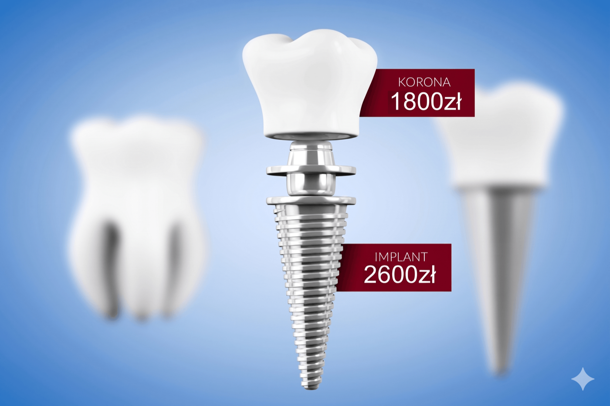

## Promocja

## Implanty Warszawa i okolice

Zapewniamy kompleksowe leczenie implantologiczne.

Implant jest sztucznym korzeniem zęba wszczepianym w miejsce pojedynczego braku, mnogich braków, a nawet służy do całkowitej rekonstrukcji bezzębnych szczęk. Implantację w naszym gabinecie wykonuje specjalista chirurgii stomatologicznej z wieloletnim doświadczeniem. Po umieszczeniu implantu w kości wyrostka zębodołowego możliwe jest wykonanie uzupełnienia protetycznego, które doskonale zastępuje naturalne zęby pacjenta.

Posiadamy duże doświadczenie, dzięki któremu gwarantujemy leczenie implantologiczne na najwyższym poziomie. Przy niedoborach kości wiemy jakie zabiegi rekonstrukcyjne są konieczne, żeby zapewnić jak najlepszy rezultat. Wszystkie procedury dobieramy indywidualnie do pacjenta oraz oczekiwanego efektu. W zależności od wskazań wykonujemy uzupełnienia w postaci koron, mostów lub pełnej odbudowy zgryzu na implantach.

**Nie czekaj już dłużej.** Implant odtwarza funkcję zęba i przywraca prawdziwy uśmiech.

### Odbudowa zgryzu

Implanty zapewniają przywrócenie pacjentowi komfortu, pozwalają na stałe i trwałe uzupełnienie braków zębowych. Odbudowa nawet pojedynczego ubytku zębowego umożliwia prawidłową funkcję żucia oraz równowagę układu stomatognatycznego. Leczenie implantologiczne zapewnia wygodę i estetyczny wygląd.

### Implanty tytanowe

Implanty wybierane w naszym gabinecie produkowane są z wysokiej jakości tytanu. Materiał ten zapewnia wyjątkową trwałość, a co najważniejsze organizm doskonale go toleruje.

### Zabieg implantologiczny

Zabieg wszczepienia implantu odbywa się w znieczuleniu miejscowym, zapewniającym bezbolesność, a pacjent następnego dnia może normalnie funkcjonować.

## Konsultacje przed zabiegiem implantologicznym

Pierwszym krokiem przed leczeniem implantologicznym jest konsultacja z doświadczonym lekarzem – specjalistą chirurgii stomatologicznej. Podczas konsultacji lekarz zapozna się z Państwa stanem uzębienia oraz oczekiwaniami. Pan doktor szczegółowo wyjaśni na czym polega leczenie implantologiczne oraz ustali harmonogram leczenia. W zależności od zaplanowanych zabiegów stomatologicznych dobierze wszystkie niezbędne badania.

## Wszczepienie implantu

Zabieg wszczepienia implantu wykonywany jest w bezpiecznym znieczuleniu miejscowym. Wprowadzony implant goi się przez okres od 3 do 6 miesięcy. W następnym etapie odsłaniamy gojący się implant i przystępujemy do wykonania końcowej odbudowy protetycznej.

## Oferta

Obecnie leczenie implantologiczne jest dostępne dla szerszej grupy pacjentów. W naszym gabinecie lekarze tak dostosują terminy kolejnych etapów leczenia, żeby nie obciążać Państwa budżetu. Gdy wezmą Państwo pod uwagę to, że z czasem protezy mogą wyrządzić szkodę sąsiadującym zębom okazuje się, że wszczepienie implantu jest ekonomiczną metodą leczenia, która na lata zapewnia dobry wygląd i komfort użytkowania.

## Implanty - pytania i odpowiedzi

### Czy wszczepienie implantu jest bolesne?

Z całą mocą należy podkreślić że wszczepienie implantu nie jest bolesnym zabiegiem. Prosta ekstrakcja zęba z punktu widzenia dolegliwości śródzabiegowych jak i pozabiegowych jest większym i bardziej inwazyjnym zabiegiem niż implantacja.

### Jak długo trwa zabieg implantacji?

Implantacja jest niejednokrotnie zabiegiem wymagającym więcej poświęconego czasu na samo przygotowanie zabiegu (sterylne warunki), niż trwa sam zabieg. Wszczepienie pojedynczego implantu trwa około 15-20 minut. Czas wszczepienia dwóch sąsiadujących ze sobą implantów jest niewiele dłuższy. Przy większej ilości wszczepów, co oczywiste, czas trwania zabiegu odpowiednio się wydłuża.

### Zgłosiłabym się na zabieg wszczepienia implantu, ale jest to za droga metoda leczenia dla mnie.

Leczenie implantologiczne jest relatywnie o wiele tańsze niż jeszcze np. 10 lat temu. Obecnie implantologia jest metodą leczenia, na którą coraz więcej pacjentów może sobie pozwolić.

### Skąd wynika tak niska cena w Państwa gabinecie? Czy to jest jakiś gorszy system implantologiczny?

W Vitadentice wszczepiamy implanty renomowanych producentów Alpha-bio, Bego. Niska cena wynika z dużej ilości wykonywanych przez nas zabiegów. Przy dużej liczbie zamawianych implantów, mamy indywidualne kontrakty z firmami implantologicznymi, co później pozwala na obniżenie cen czy organizowania promocji dla Was Drodzy Pacjenci.

### Jak długo trwa procedura od wszczepienia implantu do założenia korony?

Po wszczepieniu implantu w żuchwie należy odczekać 3, a w szczęce 5 miesięcy. Jest to czas w którym dochodzi do osteointegracji implantu z kością. Po tym czasie jest zakładana śruba gojąca dziąsło na okres ok. 2 tygodni. Następnie wykonuje się wyciski, a po ok. 2 tygodniach można już cieszyć się nowym zębem. Po zsumowaniu daje nam to ok. 4 miesięcy w żuchwie i 6 miesięcy w szczęce.

### Złamana jedynka, ząb do usunięcia. Co dalej? Czy przez okres gojenia implantu będę bez zęba?

Oczywiście, że nie. Na czas gojenia implantu, można zastosować koronę tymczasową, tak żeby okres leczenia był jak najbardziej komfortowy dla Państwa.

### Mieszkam za granicą, ale z uwagi na proponowane przez Państwa ceny, jestem zainteresowany leczeniem w Państwa gabinecie stomatologicznym. Czy jest to problem?

Nie zauważyłem znaczącego problemu w tej kwestii. Po zabiegu wszczepienia implantu, można zastosować szwy resorbowalne, tak żeby Państwo nie musieli ich zdejmować w innych, obcych placówkach. Kolejną wizytę umawiamy po 3 lub 5 miesiącach, odpowiednio dla implantu wszczepionego w żuchwę lub szczękę. Następnie potrzebne są 2 tygodnie na dokończenie leczenia lub rozłożenie końcowego etapu leczenia na 2-3 jednodniowe wizyty.

### Czy do odbudowy większej ilości zębów, na przykład 3 sąsiadujących ze sobą braków potrzebne jest wszczepienie 3 implantów?

Jeśli występują mnogie ubytki uzębienia, powinno się zastosować mosty na implantach. W przypadku brakujących 3 zębów, które sąsiadują ze sobą, wszczepiam 2 implanty, w miejsce skrajnych ubytków, na których zamocowane są 3 korony. Np. Jeśli brakuje zęba nr 5, nr 6 i nr 7, to wszczepiam implanty w pozycji zęba nr 5 i nr 7, a następnie końcową odbudową protetyczną będzie most 3 punktowy z koronami na implantach zębów 5 i 7, które są połączone koroną protetyczną odbudowującą brakujący ząb w pozycji nr 6. Czasami jest możliwość odbudowy 4 zębów na 2 implantach. Niekiedy, przy brakujących dwóch sąsiadujących ze sobą zębach lepiej jest wesprzeć dwie korony zębowe na jednym implancie, niz dwóch niezależnych implantach. Do odbudowy połowy jednego z łuków zębowych, na ogół wystarczają 3 implanty, co pociąga za sobą, że odbudowa całkowita jednego łuku zębowego może być wsparta na 6 implantach.

### Nie mam zębów, inny lekarz powiedział mi ze nie kwalifikuję się do zabiegu implantacji z uwagi na niewystarczającą ilość kości. Czy jest na to jakaś rada?

W przypadku deficytu kości, można zastosować jej odbudowę, za pomocą kości własnej, czy też jej substytutów. W przypadku znacznych zaników i dużego ryzyka niepowodzenia zabiegu odbudowy kości można pomyśleć o innym rozwiązaniu: proteza overdenture na implantach.

I tak w przypadku bezzębnej szczęki należy wszczepić 4 implanty, przy bezzębnej żuchwie wystarczają 2 implanty. Następnie implanty służą jako zaczepy do mocowania przyszłej protezy. W szczęce oprócz silnego zamocowania protezy do elementów retencyjnych zyskujemy zmniejszoną powierzchnię przylegania do podniebienia. Wielu pacjentom przeszkadza zasłonięte podniebienie płytą zwykłej, akrylowej protezy. Pacjenci ci skarżą się na odruch wymiotny, gorszą możliwość odczuwania smaku czy temperatury spożywanych pokarmów. Przy protezie wspartej na implantach można ograniczyć zasięg protezy, co likwiduje powyższe problemy.

### Czy po zabiegu występują duże dolegliwości bólowe?

Na ogół dolegliwości nie są duże. Mogą występować w dniu zabiegu, po zakończeniu działania środka znieczulającego i stopniowo tracą swoją intensywność w ciągu 3-5 dni. Po zabiegu wypisuję receptę na antybiotyk i lek przeciwbólowy, które pomagają łagodzić dolegliwości pozabiegowe.

### Czy po zabiegu będę mógł/mogła pójść do pracy?

Jeżeli nie jest to praca fizyczna lub praca wymagająca bezpośredniego kontaktu z klientem, nie widzę przeciwwskazań. W przypadku prac fizycznych, warto się powstrzymać od nich przez kilka dni.

### Chętnie bym wszczepił/a implant, ale jestem uczuleniowcem/alergikiem.

Implant jest wykonany z tytanu, który jest jednym z najrzadziej uczulających metali. Jeśli chodzi o leki, na które możecie być Państwo uczuleni, a które lekarz wypisuje po zabiegu, należy poinformować o tym fakcie lekarza, to wtedy zapisze antybiotyk/lek przeciwbólowy z innej, bezpiecznej dla Państwa grupy leków.

---

[UMÓW WIZYTĘ U NASZEGO IMPLANTOLOGA JUŻ DZIŚ](/kontakt)
