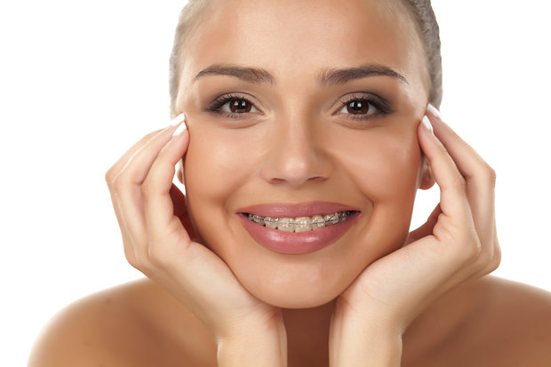
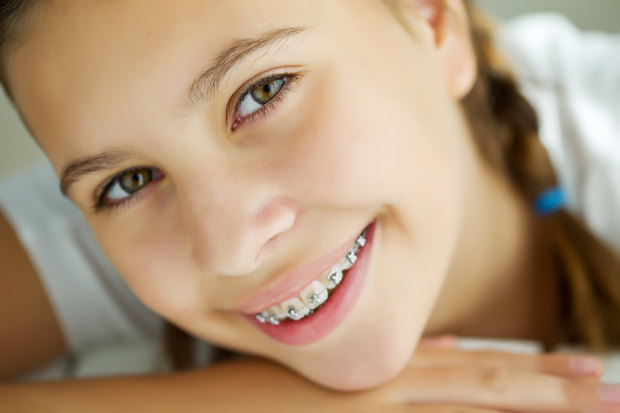
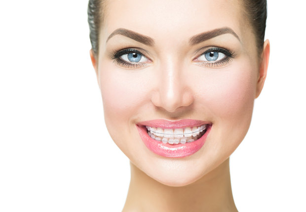

Uczestniczka szkoleń:

    

## Zapewniamy kompleksowe leczenie ortodontyczne

Ocena człowieka przez otoczenie na podstawie wyglądu, zwłaszcza twarzy, przebiega błyskawicznie. Wystarczy 1/10 sekundy, byśmy do nowo poznanej osoby poczuli sympatię lub niechęć. Natomiast ogólne pierwsze wrażenie robimy w ciągu niespełna jedenastu sekund. Za 83% tego wrażenia odpowiada sympatycznie uśmiechnięta twarz. Zdaniem ekspertów z dziedziny psychologii istnieje zjawisko zwane efektem aureoli. Polega ono na przypisywaniu cech osobowości na podstawie miłej aparycji. Pierwsze wrażenie determinuje całą przyszłą relację.

Prawidłowe ustawienie zębów jest jednak nie tylko kluczem do osiągnięcia atrakcyjnego wyglądu, ale przede wszystkim czynnikiem istotnie wpływającym na skuteczniejszą higienę, zmniejszenie ryzyka występowania próchnicy oraz paradontozy, a także przyczynia się do zniwelowania istniejących wad wymowy.

### Ortodoncja dorosłych

Prawidłowe dobranie aparatu ortodontycznego jest procesem złożonym. Gwarantujemy profesjonalną i precyzyjną analizę Twojego przypadku. Efektem będzie piękny i zdrowy uśmiech.

### Ortodoncja dzieci

W naszym gabinecie stomatologicznym leczymy wady zgryzu u dzieci. Diagnostyka i planowanie leczenia ortodontycznego u dziecka jest szczególnie istotne, bo pozwoli mu uniknąć problemów w dorosłym życiu. [Zobacz ruchome aparaty ortodontyczne](#ruchome-aparaty-ortodontyczne).

### Doświadczenie

Wszystkie zabiegi wykonują lekarze z ogromnym doświadczeniem, które pozwala osiągnąć najlepsze rezultaty, w komfortowych warunkach i dobrej atmosferze.

## Ortopedia szczękowa

Ortopedia szczękowa to dziedzina stomatologii zajmująca się badaniem narządu żucia, badaniem wpływu działania czynników korzystnych i niekorzystnych na narząd żucia i na powstawanie określonych wad zgryzu. Ta gałąź stomatologii trudni się również wczesnym leczeniem powstałych wad zgryzu aparatami ruchomymi (wyjmowanymi) oraz terapią aparatami stałymi (aparatami klejonymi na zębach).

## Ruchome aparaty ortodontyczne

Wczesne leczenie zgryzu jest niezwykle ważne dla zdrowia i pięknego uśmiechu dziecka. Ruchome aparaty ortodontyczne to najczęściej akrylowe płytki wykonywane w laboratorium ortodontycznym. Leczenie takimi aparatami przyniesie najlepsze rezultaty, kiedy ich stosowanie rozpoczniemy w wieku 6-8 lat. Moi mali pacjenci użytkują tego rodzaju aparaty w ciągu nocy oraz dodatkowo przez ok. 2-3 godziny w ciągu dnia. Aby dzieci były zmotywowane i chętne do leczenia, wykonujemy je we wszystkich kolorach tęczy i z ozdobami, jakie tylko wyśnią się maluchom.

## Aparat Invisalign

Jeśli marzysz o zdrowym, pięknym uśmiechu, ale z jakichś względów nie chcesz lub nie możesz mieć zamków na zębach, rozwiązaniem doskonałym jest precyzyjny nakładkowy system Invisalign, w którym leczenie przeprowadzane jest indywidualnymi, dokładnie zaprojektowanymi szynami nazębnymi. Jest to procedura idealna dla osób, które oczekują najlepszych rezultatów przy jednocześnie minimalnie zauważalnym aparacie. [Więcej o systemie Invisalign®](/invisalign).

## Stałe aparaty ortodontyczne

Główny podział stałych aparatów ortodontycznych możemy tutaj, dla uproszczenia, sprowadzić do podziału na aparaty metalowe oraz estetyczne aparaty kryształowe.
Stałe aparaty na zęby stosuję najczęściej u pacjentów w wieku powyżej 12 lat. Istnieją jednak niekiedy wskazania, abym leczenie takim aparatem rozpoczęła wcześniej. Równolegle tego typu terapię prowadzę również z powodzeniem w przypadku nieprawidłowości ortodontycznych u osób nawet znacznie zaawansowanych wiekiem. Nowoczesna ortodoncja do minimum obniża prawdopodobieństwo konieczności usuwania zębów, a także przedstawia rozwiązania dla naprawdę trudnych wad. W dużej mierze pomaga w tym zastosowanie mikroimplantów ortodontycznych, które również są przeze mnie wykorzystywane.

## Ortodoncja - pytania i odpowiedzi

### Kiedy powinno się zgłosić z dzieckiem po raz pierwszy na badanie ortodontyczne?

W wieku ok. 3 lat. Rodzic nie zawsze zauważy, że coś w jamie ustnej dziecka nie jest normą. Trzyletni maluszek jest na tyle rozwinięty, że możemy zwykle, jeśli istnieje taka konieczność, przeprowadzać z nim proste ćwiczenia lub używać przyjaznych nieskomplikowanych aparatów ruchomych. Kiedy natomiast mamy do czynienia z normą zgryzową, to następne wizyty u ortodonty powinny się odbyć w wieku ok. 5-6 lat, a potem 11-12 lat.

### Czy ssanie smoczka, palca przez moje dziecko powinno zostać wyeliminowane?

Tak, bo takie czynności (parafunkcje), podobnie zresztą jak nieprawidłowy tor oddychania, czy niewłaściwy sposób połykania śliny, układania języka (dysfunkcje) zaowocują, niestety, w przyszłości wadą zgryzu. Na szczęście mamy metody na skuteczną eliminację tych działań z pomocą pięknych wyjmowanych aparatów.

### Czy noszenie aparatu wyjmowanego boli?

Nie. Stosowane siły są niewielkie. Jednak motywowanie dziecka jest bardzo ważne, bo mała pociecha nie do końca widzi albo niekoniecznie rozumie, dlaczego w ogóle powinna używać aparatu. Dobrze, że ja świetnie dogaduję się z dziećmi i mogę liczyć na dobrą z Nimi współpracę.

### Czy zakładanie stałego aparatu ortodontycznego boli?

Nie. Założenie aparatu na zęby jest natomiast czynnością pracochłonną, wymaga dużego skupienia i winno być wykonane z wysoką precyzją, a także należytą dokładnością, co powoduje, iż zabieg nie przebiega szybko, trwa około godziny.

### Czy noszenie stałego aparatu ortodontycznego boli?

Nie. Na początku trzeba się do niego przyzwyczaić, bo zajmuje on po prostu pewne miejsce w jamie ustnej, ale ten proces trwa zwykle, według moich pacjentów, około 2-3 dni. Potem wargi i policzki adaptują się do nowych warunków.

### Czy będę musiał szczególnie dbać o higienę podczas leczenia aparatem stałym?

Zachowanie prawidłowej higieny jamy ustnej jest konieczne, gdyż stan zapalny dziąseł powstaje już w ciągu 2 dni niewłaściwej pielęgnacji, a przedłużająca się zła higiena może również źle wpłynąć na szkliwo zębów. Wskazane zatem jest okresowe profesjonalne czyszczenie zębów, piaskowanie, czasem skaling, czyli ultradźwiękowe zdjęcie kamienia.

### Jestem alergikiem. Czy stały aparat jest dla mnie bezpieczny?

Tak. Stosuję wyłącznie zamki bezniklowe (kryształowe i metalowe Ni-free), a to nikiel jest najczęściej czynnikiem alergizującym. Zdarzają się też pacjenci, którzy są uczuleni na nikiel zawarty w standardowych łukach Ni-Ti, ale w obecnych czasach, przy wysoko zaawansowanej technologii ortodontycznej, to również nie jest źródłem problemu, bo powszechne łuki niklowo - tytanowe zastępuję wówczas łukami beta - tytanowymi.

### Czy da się ustawić ładnie mój ząb, który do tej pory się nie wyrżnął i tkwi w kości?

W znakomitej większości przypadków taki ząb przesuniemy jak po sznureczku w jego właściwe położenie. Duże znaczenie ma, naturalnie, jego usytuowanie, które ocenię dokładnie analizując odpowiednie zdjęcia rentgenowskie, a niekiedy stosowne obrazy tomografii komputerowej.

### Moje górne dwójki nie wyrosły. Nie podobają mi się szpary w miejscach, gdzie powinny być te zęby. Co można zrobić?

Zdarza się czasem, że określone zęby zatrzymują się w kości i z jakiegoś powodu nie wyrzynają się. To jednak częściej dotyczy trójek, czy ósemek. W przypadku górnych dwójek, czy dolnych piątek jest to raczej związane z brakiem zawiązków tych zębów. Następstwem tego są późniejsze braki. Zawiązki zębów mlecznych zaczynają się tworzyć ok. 50-go dnia życia zarodkowego, a pierwsze zawiązki zębów stałych powstają w 4-ym miesiącu życia płodowego. Jeśli tremy (wspomniane szpary) są wąskie, można dokonać korekty wyglądu trójek i ustawić je w miejscu brakujących dwójek. W podobny sposób można zabudować miejsce brakujących dolnych piątek, usuniętych zębów dodatkowych, usuniętych zębów zniszczonych. Jeśli natomiast tremy są szersze, można te miejsca pozostawić lub nawet powiększyć, a w przyszłości, na ostatnich etapach leczenia ortodontycznego, odbudować brakujące zęby implantami lub po zakończeniu leczenia aparatem odtworzyć zęby protetycznie z użyciem mostów.

### Mam złamaną jedynkę, która została odbudowana wypełnieniem. Czy można w tej sytuacji założyć aparat na zęby?

Tak. Wymieniona sytuacja nie jest przeciwwskazaniem do leczenia stałym aparatem ortodontycznym. Jeśli natomiast odbudowa nie jest wystarczająco estetyczna, to po ukończeniu terapii, należy rozważyć wykonanie nowej.

### Mam koronę na dwójce. Czy jest to przeciwwskazanie do noszenia stałego aparatu?

Nie. Możemy śmiało planować leczenie. W obecnej dobie zaawansowania technologicznego systemy wiążące są wysoko specjalizowane. Dobierając odpowiedni zestaw produktów, korona protetyczna okazuje się zwykle dobrym elementem do utrzymania zamka ortodontycznego.

### Czy będzie istniała u mnie konieczność usuwania zębów?

Jest to, oczywiście, kwestią indywidualną, ale ogólnie mamy obecnie do dyspozycji metody, aparaty, elementy dodatkowe, w tym rewelacyjne miniimplanty ortodontyczne, które omówię, z Państwem, drodzy pacjenci, po przeanalizowaniu zdjęcia cefalometryczego i diagnostycznych modeli gipsowych, indywidualnie, a które bardzo często eliminują konieczność ekstrakcji zębów w celu przeprowadzenia leczenia ortodontycznego.

### Straciłem już wiele zębów, a te, które zostały, są krzywe. Czy można coś z nimi zrobić przed leczeniem protetycznym?

Naturalnie. Jest możliwe, abyśmy najpierw ustawili prawidłowo zęby własne, a potem dopiero odbudowali braki zębowe. Taki tryb pozwoli nam wykonać ładne odbudowy protetyczne. W sytuacji, kiedy od dawna nie mamy uzupełnionych brakujących zębów, te, które zostały, mogły ulec przemieszczeniu lub patologicznemu starciu na skutek ich nadmiernego zużycia oraz przeciążenia. Przeprowadzenie od razu leczenia protetycznego może wiązać się z trudnością dopasowania zębów protetycznych do krzywych zębów własnych. Dobrym planem leczenia będzie tu więc strategia obejmująca w pierwszym etapie leczenia ładne ustawienie zębów obecnych w jamie ustnej, a dopiero w kolejnym etapie wykonanie dopasowanej do prostych zębów odbudowy protetycznej.

### Mieszkam na stałe za granicą. Nie będę mógł przyjeżdżać na częste wizyty. Czy możliwe jest, abym leczył się w Państwa gabinecie?

Tak. W tej sytuacji założymy aparat samoligaturujący. Wizyty kontrolne będą mogły odbywać się wówczas co ok. 8 tygodni. Znaczne wydłużanie interwałów czasowych pomiędzy wizytami skutkuje brakiem właściwej kontroli i przedłużaniem się leczenia.

### Czy mogę mieć na górze aparat estetyczny, a na dole metalowy?

Tak. Możliwa jest też konfiguracja, gdzie zarówno na górze, jak i na dole założymy zamki kryształowe na zęby przednie, a na zęby boczne górne oraz dolne - zamki metalowe.

### Estetyczny aparat mojego znajomego uległ przebarwieniu. Czy to się często zdarza?

Nie w mojej praktyce, gdyż jedyne aparaty estetyczne, które stosuję to wysokogatunkowe aparaty kryształowe. Ewentualne przebarwienia aparatów estetycznych mogą się zdarzyć przy zamkach kompozytowych, czy porcelanowych, lecz ja takowych nie używam.

---

[UMÓW WIZYTĘ U NAS JUŻ DZIŚ](/kontakt)
